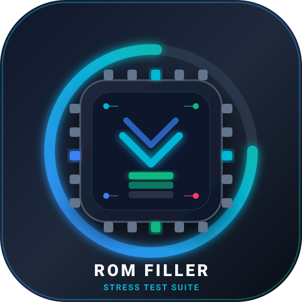

<p align="center">
  
</p>

<h1 align="center">WriteRom · ROM 存储极限填充与压测工具</h1>

<p align="center">
  <b>面向 Android 设备的闪存空间填充、低存储（Low Storage）边缘场景验证与闪存老化测试工具</b><br>
  <i>Android flash storage filler, low-storage scenario simulator, and wear-leveling stress testing utility.</i>
</p>

<p align="center">
  
  
  
  
  
</p>

---

## 📖 项目简介

**WriteRom** 是一款专为 Android 开发者、测试工程师（QA）以及系统固件调优人员打造的**存储空间填充与低存储压力测试工具**。

在移动应用测试与系统 ROM 开发中，验证应用在闪存空间即将耗尽（Low Storage / Out of Space / ENOSPC）极端场景下的鲁棒性至关重要。WriteRom 支持以高吞吐量向手机 ROM 写入大块数据文件、真实合规 JPG 图片以及标准 MP4 视频，并提供精确的阈值设置与一键清理还原机制，帮助快速复现与验证极限边缘场景。

---

## ⚡ 核心功能特性

### 1. 真实精确的 ROM 存储状态动态感知
* **双重动态推演与校准**：基于 `StatFs` 与已写入字节数（每 400ms 刷新一次），使顶部 **手机 ROM 存储状态** 模块与彩色环形进度条伴随写入平滑动态跳动；文件落盘后自动同步 Linux 文件系统底层最新数据块。
* **防溢出安全硬约束**：设定阈值无论如何调整，计算出的实际填充量**绝对不会超过手机自身的可用 ROM 大小**。

### 2. 灵活的填充阈值与策略设置
* **保留剩余空间模式**：允许自定义保留空间（**默认保留 0 MB**，支持榨干闪存进行极限压测）。
* **目标占用比例模式**：支持一键将 ROM 占用比例填充至 90%、95%、99% 乃至 100%。
* **指定填充大小模式**：支持直接指定填充大小（例如填充 10GB、50GB）。
* **实时预估计算**：滑动调节阈值时，实时演算并显示本次任务预计还将写入的真实数据量。

### 3. 多介质、多类型填充内容支持
* **大块普通文件（RAW_FILE）**：
  * **零字节极速填充（Zero-fill）**：以极高吞吐量快速占位；
  * **随机伪数据（Random Data）**：生成不可压缩的高熵数据，真实消耗闪存块，防止 F2FS / ZRAM 等透明压缩算法抵消存储占用。
* **真实合规图片（IMAGE）**：
  * 动态生成带有时间戳、色彩梯度和几何噪点的合法 JPEG 图片，可被系统与第三方相册正常索引与生成缩略图。
* **真实合规视频（VIDEO）**：
  * 基于 ISO-BMFF 标准规范构建合规 MP4 容器结构，支持播放器正常解码与相册视频预览。
* **电话联系人通讯录（CONTACTS · v1.7 新增）**：
  * **系统 ContactsProvider 批量事务注入**：基于 Android 原生 `ContentProviderOperation.applyBatch` 高速批量注入真实多样化中文姓名、多运营商号段电话、工作邮箱与测试备注，专项压测 SQLite `contacts2.db` 数据库 B-Tree 索引、WAL 日志、拨号盘 T9 实时检索与 CursorWindow 内存开销；
  * **超大姓名空间与零重复保障**：扩充百家姓与多音韵常用字库（220+ 姓氏、14,480+ 名字，组合空间达 318 万+ 自然姓名），融合数学同余双射置换与运行时数据库碰撞自旋校验，**彻底杜绝任何重复姓名生成**；
  * **全制式多样化号段**：覆盖中国移动、中国联通、中国电信、广电及虚拟运营商共 44 种号段，电话号码真实多样，告别单一固定号段；
  * **独立账户与极致吞吐优化**：采用 `com.mobiiot.writerom` 独立专属账户，开启 `AGGREGATION_MODE_DISABLED` 绕过系统耗时的人脸/头像聚合，批处理吞吐量提升 10 倍以上（单机可达 500+ 联系人/秒）。
* **四合一混合模式（MIXED · v1.7 升级）**：
  * **大文件、图片、视频、联系人四合一同步并发填充**：多工作线程采用模 4 轮询分发策略，全自动并行交叉生成大文件、高质图片、合规视频与结构化联系人，全面模拟真实设备极端混合重载环境。

### 4. 媒体与数据可见性隔离与安全防护
* **多媒体专属目录防污染**：默认所有生成的多媒体与文件存储在应用专属隔离目录中（`.nomedia` 隔离），**绝不污染用户的日常个人相册**。
* **系统相册导入开关**：可手动勾选【导入系统相册】，开启后主动向 Android `MediaStore` 触发扫描与索引，用于专项压测相册缩略图生成器（MediaScanner）的系统负载。
* **联系人专属账户与零污染隔离**：所有生成的联系人全部绑定独立账户类别（`ACCOUNT_TYPE = "com.mobiiot.writerom"`），与用户个人联系人彻底逻辑隔离，一键清理时通过 `CALLER_IS_SYNCADAPTER=true` 实现原子物理硬删除，绝不误伤或污染个人真实通讯录。

### 5. 高级压测与并发控制 (v1.2 新增)
* **1~8 线程自由并发调度**：
  * 支持 1、2、4、8 线程弹性伸缩，多线程协同共享剩余填充配额（`AtomicLong` 原子分发），充分榨干 UFS / eMMC 闪存主控的多通道并行读写吞吐能力。
  * 实时状态栏与 UI 仪表盘实时呈现“X 线程并发”徽标，并以千位分隔符展示已创建文件总量。
* **文件系统碎片化填充模式 (Mass Small Files)**：
  * **极限 Inode 与元数据（Metadata）冲击**：摆脱单一的大文件顺序写入，支持连续写入成千上万个 4KB ~ 256KB 的零散碎片文件，用于模拟长周期碎片化、测试闪存磨损均衡（Wear-Leveling）与 Linux 内核 VFS 目录索引树性能。
  * **分级目录散列管理（Directory Bucket Hashing）**：按每 500 个文件自动归档至独立散列子目录（`frag_bucket_000` ~ `frag_bucket_999`），杜绝单一目录超量节点导致 ext4/f2fs 线性遍历瘫痪或内核软死锁。
  * **三档碎片规格可选**：
    * `极小碎片 (4KB ~ 16KB)`：高密度元数据读写与极限碎片化；
    * `常用碎片 (32KB ~ 128KB)`：日常应用缓存与微日志碎片分布模拟；
    * `混合高熵 (4KB ~ 256KB)`：全跨度尺寸碎片交织填充。
    * **规格互斥与双向联动设计**：分块大小（`256MB` / `500MB` / `1024MB`）与碎片化小文件规格在 UI 与引擎层完全互斥并双向实时联动（点击任一大分块自动退出碎片化，反之亦然），实时仪表盘与常驻通知栏明确标明“当前生效规格”，彻底消除配置歧义与优先级混乱。
* **真实穿插打孔 (Write & Punch)**：
    * 模拟长期使用下的物理不连续碎块，每累计生成 500 个微文件时，以 30% 概率随机穿插剔除部分微文件，在闪存物理块中制造非连续的空白空洞，强迫底层闪存主控在后续写入时频繁触发垃圾回收（GC）与坏块迁移。

### 6. 实时性能衰减折线图与 SLC Cache 耗尽感知 (v1.3 新增)
* **Compose Canvas 平滑贝塞尔曲线渲染**：
  * 基于 `Canvas` API 与平滑贝塞尔算法，以秒级时间窗口（40秒滑动窗口）实时绘制写入吞吐性能演进趋势，杜绝生硬折线与锯齿。
  * 曲线下方采用主色垂直渐变微光填充，配合参考虚线网格、全程均速参考线与峰值速率指示。
* **SLC Cache 耗尽特征自动识别**：
  * 针对现代 UFS / eMMC 固态闪存的 SLC 模拟缓存特性，实时监测速率骤降（从峰值断崖式下跌至 40%~50% 以下），自动标注 **“⚡ SLC Cache 已耗尽”**，直观展现从高速缓存写入向 TLC/QLC 物理颗粒原生直写与后台搬迁（Folding/GC）的过渡状态。

### 7. UFS/eMMC 闪存寿命与芯片温度感知 (v1.3 新增)
* **设备核心温度实时感知**：
  * 基于电池与硬件传感器高频采样设备芯片温度（精度 0.1°C），划分四档温控安全等级（正常冷感 / 轻度温升 / 偏热负载 / 严重过热）。
* **系统热节流 (Thermal Throttling) 状态监测**：
  * 深度接入 Android 10+ (API 29) 官方 `PowerManager.OnThermalStatusChangedListener`，实时感知系统底层是否已对 CPU/闪存主控实施降频降温保护。
* **闪存损耗与 TBW 寿命统计**：
  * 持久化统计 WriteRom 累计总写入数据量（TBW），并根据设备 ROM 物理容量动态换算当前已消耗的相当完整 P/E 擦写循环次数，直观评估对闪存颗粒的老化影响。

### 8. 前台服务常驻与平滑控制
* 采用 `ForegroundService` 结合 `PARTIAL_WAKE_LOCK`，确保锁屏或切到后台时填充任务不被系统 Low Memory Killer 中断。
* 常驻通知栏实时展示瞬时写入速率（MB/s）、当前并发线程数、SLC 耗尽状态、已写入进度与预计剩余时间（ETA）。
* 支持 **【开始】**、**【暂停】**、**【恢复填充】**、**【终止任务】** 平滑控制。

### 9. 一键极速清理、进度感知与安全中断
* **专属目录与碎片极速清空**：独立追踪所有生成的数据，后台异步彻底递归删除所有大文件与散列碎片目录（`frag_bucket_*`），并同步通知系统剔除 MediaStore 索引，瞬间恢复手机可用存储空间。
* **系统通讯录专属测试数据硬删除**：联动彻底物理删除所有由 WriteRom 生成的测试联系人（通过 `CALLER_IS_SYNCADAPTER=true` 执行永久物理硬删除，不留墓碑残余，且绝不波及用户个人联系人），同步回收 SQLite 数据库与 WAL 存储空间。
* **实时动态进度感知**：清理过程中展示直观的高频反馈看板，清晰呈现“已清理 X / Y 个文件”与“已释放 Z GB 空间”，配备确定型/平滑双模进度条，拒绝盲目等待。
* **支持中途安全终止（停止清理）**：针对千万级微文件或海量占用耗时场景，提供醒目的 **【停止清理】** 红色操作按钮，采用原子线程信号安全即时中断递归删除，立即结算并保留已释放的空间成果。

### 10. 全局悬浮微型仪表盘 (Floating HUD) (v1.4 新增)
* **跨 App 全局悬浮监控**：基于 Android 系统 `WindowManager` 与 Jetpack Compose 深度整合（通过 `FloatingHudLifecycleOwner` 独立生命周期桥接），允许用户在切至系统相机、相册或任意第三方被测 App 时，在屏幕任意位置置顶悬浮监控手机 ROM 剩余容量。
* **二段式自适应形态**：
  * **紧凑胶囊态（Mini-Pill）**：36dp 高度半透明深色磨砂药丸，呈现剩余空间、瞬时速率与红/橙/绿三级低存储警戒色彩，占屏极小、绝不遮挡被测应用关键操作；
  * **展开微看板态（Expanded Card）**：单手点击即可原地展开，完整查看 ROM 占用进度条、并发线程数、芯片温度与温控等级，并提供 **【暂停 / 恢复】**、**【终止任务】** 与 **【返回应用】** 快捷操作。
* **手势自由拖拽与智能贴边磁吸**：支持在屏幕全局任意手势拖拽位移，松手后根据屏幕中线自动执行减速贴边磁吸动画（`DecelerateInterpolator`），顺滑收纳至左/右边缘。
* **后台数据零延迟双通道直连**：前台服务 `StorageFillerService` 与 Activity 双通道分发，即便宿主应用切至后台或息屏亮屏，悬浮看板依然毫秒级动态刷新。

### 11. 专属定制微芯片图标
* 配备全套 Android Adaptive Icon 自适应矢量图标与全密度位图（`mipmap-xxxhdpi` 等），适配现代 Android 系统的圆角、方形、圆形及单色桌面规范。

### 12. 现代化 Glassmorphic Bento 工业级视觉与响应式自适应系统 (v1.5 新增)
* **常驻底部半透明悬浮控制岛 (Sticky Bottom Action Bar)**：
  * 采用磨砂半透明高斯模糊面板，脱离传统长列表底部遮挡，实时感知并响应当前任务状态（空闲、写入、暂停、清理）；
  * 清理进行中实时滚动显示释放进度条，写入中显示瞬时速率、进度与快捷控制按钮。
* **物理弹簧微动效与触感震动反馈 (Spring Physics & Haptics)**：
  * 全局核心按钮与分段控制搭载 `Modifier.bounceClickable()` 物理弹簧阻尼微动效（`scale = 0.95f`），点击同步触发轻度触感振动，告别生硬死板的默认涟漪。
* **Neon 动态多段渐变闪存刻度规 (Neon Gradient Storage Gauge)**：
  * 依据闪存占用比例动态切换多段霓虹渐变（健康绿-青蓝、温升橙黄、满载深红玫瑰），并附带玻璃顶部微光折射高光层与 Bento 状态胶囊。
* **Glassmorphism 2.0 光感微描边与 Bento Grid 视觉层级**：
  * 全卡片采用 1dp 垂直微光渐变描边（`Modifier.glassBorder`），Dark Slate（`#0B0F17` / `#161B26`）深色基底，消灭单调扁平灰卡。
* **手机单栏智能上下文折叠 (Runtime Context Folding)**：
  * 任务执行期间自动将低频配置参数（阈值、介质类型、高级压测）平滑折叠，聚合焦点于实时速率曲线、监控与硬件感知看板，并支持一键顺滑展开。
* **手机与平板双模响应式自适应布局 (Adaptive `screenWidthDp >= 600dp`)**：
  * 平板、折叠屏展开态或横屏模式下自动切换为对称双栏 Bento 布局，左栏遥测、右栏参数，空间利用充分优雅。

### 13. UI 精简升级、上下平行层次重构与悬浮窗鲁棒性优化 (v1.6 新增)
* **视觉文案大幅精简与排版可读性升级**：
  * 剔除各模块重复繁冗的描述性副文本，字号与触控目标全面升级（主标题提升至 19sp Bold，数据指示文本提升至 15.5~16.5sp，霓虹进度条高度由 18dp 增至 24dp）；
  * 去除存储总览中进度条上方重复的“剩余”文字，精简聚焦于“已占用”进度，由下方双格 Bento 胶囊专注承载“已用空间”与“当前可填充”。
* **全卡片标题与状态胶囊「上下平行」Bento 排布**：
  * 将「手机 ROM 存储状态 & 总容量」、「实时写入性能衰减曲线 & SLC 缓存加速」、「闪存健康与芯片感知 & UFS/EMMC 状态」、「实时写入监控 & 并发线程」、「高级压测与并发设置 & 并发碎片」等核心卡片标题栏统一由水平并列重构为纵向垂直上下分布，彻底消除小屏手机横向挤压变形。
* **实时监控看板纯粹化**：
  * 移除实时监控卡片标题栏内冗余挤占的“写入规格”青蓝色胶囊（避免与底部常驻栏信息重复并消除横向挤压变形的长条色块），保留清晰纯粹的“8 线程并发”与“正在填充”状态标签。
* **全局悬浮微型仪表盘 (Floating HUD) 鲁棒性与边界贴边修复**：
  * **按键防裁切与完整两字展示**：重构展开卡片操作按钮内边距（由默认 24dp 压缩至 6dp 并锁定单行不折行），卡片宽度拓宽至 295dp，彻底修复暂停、停止、继续按钮只显示单字（“暂/终/继”）的问题；
  * **右侧屏幕遮挡自适应校准**：去除 `FLAG_LAYOUT_NO_LIMITS` 并引入 ComposeView 动态布局尺寸监听器（`addOnLayoutChangeListener`），在浮窗由空闲切换至填充测速（宽度动态增加）或展开为看板时，自动感知右侧边界并向左平滑对齐，杜绝与屏幕边缘发生遮挡；
  * **悬浮窗权限授权引导防挤压**：为权限说明文本引入弹性权重分配（`weight(1f)`），确保“去授权”按钮在窄屏下完整可见且点击灵敏。

### 14. 电话联系人 (ContactsProvider) 压测与四合一同步并发混合模式 (v1.7 新增)
* **系统通讯录批量事务注入**：
  * 基于 Android 原生 `ContentProviderOperation.applyBatch` 实现高吞吐批处理注入真实中文姓名、多样化全号段手机号、工作邮箱与测试备注，专项压测 SQLite `contacts2.db` 数据库 B-Tree 索引、WAL 日志、拨号盘 T9 实时检索与 CursorWindow 内存开销；
  * 扩充海量百家姓与名库（220+ 姓氏、14,480+ 名字，318 万+ 空间），通过同余双射置换与数据库现有姓名原子查重校验，确保连续生成与跨次运行时**人名 100% 绝对不重复创建**；
  * 电话号码覆盖移动/联通/电信/广电及虚商共 44 种前缀号段，真实多变；
  * 使用专属独立账户（`com.mobiiot.writerom`）并禁用系统自动聚合（`AGGREGATION_MODE_DISABLED`），插入吞吐速度提升 10 倍以上（单机可达 500+ 联系人/秒）；
* **四合一多线程同步并发混合模式**：
  * 在选择「混合模式」时，多工作线程协同在文件（RAW_FILE）、图片（IMAGE）、视频（VIDEO）与联系人（CONTACTS）四者间轮询并发生成，各线程跨文件系统与数据库并发写入，全方位压测系统综合 I/O 与应用性能；
* **动态权限感知与交互引导**：
  * 当选择联系人或混合模式时，自动检测 `READ_CONTACTS` 与 `WRITE_CONTACTS` 权限，未授权时智能展示友好权限提示横幅与授权引导，安全防崩溃；
* **一键无损物理清除机制**：
  * 在一键清理流程中接入 `ContactsGenerator.cleanAllContacts()`，使用 `CALLER_IS_SYNCADAPTER=true` 安全干净地物理硬删除所有 WriteRom 生成的数据，零残留且绝不触及用户私人通讯录。

---

## 🏗️ 架构设计

本项目严格遵循企业级 **Java 业务逻辑 + Kotlin Jetpack Compose UI 混编架构**：

```
┌────────────────────────────────────────────────────────┐
│               Kotlin Compose UI 表现层                 │
│    (Bento 仪表盘卡片、滑块控制、Material 3 响应式界面)   │
└──────────────────────────▲─────────────────────────────┘
                           │ 观察不可变 State / 分发 UI 事件
┌──────────────────────────┴─────────────────────────────┐
│             Kotlin 桥接层 (UiBridge.kt)                │
│    - ComposeView 桥接 (ViewCompositionStrategy 销毁)   │
│    - 不可变 StorageUiState 状态装载                     │
│    - UI 事件回调接口 (UiCallbacks)                      │
└──────────────────────────▲─────────────────────────────┘
                           │ 方法调用 / 主线程回调
┌──────────────────────────┴─────────────────────────────┐
│              Java 业务逻辑与系统层                     │
│   - MainActivity.java (宿主 Activity 与权限管理)       │
│   - StorageFillerService.java (前台服务保活常驻)       │
│   - FillEngine.java (多线程并发调度核心引擎)           │
│   - FileGenerator.java (大块数据生成，零填/随机)       │
│   - FragmentationGenerator.java (海量散列碎片小文件)   │
│   - ImageGenerator.java (标准合法 JPG 图片生成)        │
│   - VideoGenerator.java (合规标准 MP4 视频生成)        │
│   - ContactsGenerator.java (通讯录批量事务注入与硬删除)│
│   - CleanupManager.java (一键释放与多媒体/通讯录清理)  │
│   - HardwareMonitor.java (芯片温度与系统热节流监测)    │
│   - LifetimeStatsManager.java (TBW 与 P/E 寿命统计)    │
│   - StorageHelper.java (StatFs 容量感知与格式化)       │
└────────────────────────────────────────────────────────┘
```

### 目录结构规范
```text
WriteRom/
├── app/
│   ├── src/main/
│   │   ├── java/com/mobiiot/writerom/
│   │   │   ├── engine/          # [Java] 核心多线程任务调度与空间清理引擎
│   │   │   │   ├── FillEngine.java
│   │   │   │   └── CleanupManager.java
│   │   │   ├── generator/       # [Java] 文件、碎片、图片、视频、联系人生成器
│   │   │   │   ├── FileGenerator.java
│   │   │   │   ├── FragmentationGenerator.java
│   │   │   │   ├── ImageGenerator.java
│   │   │   │   ├── VideoGenerator.java
│   │   │   │   └── ContactsGenerator.java
│   │   │   ├── model/           # [Java] 存储状态、压测配置与进度数据模型
│   │   │   │   ├── FillConfig.java
│   │   │   │   ├── FillProgress.java
│   │   │   │   ├── FragmentSizeLevel.java
│   │   │   │   └── ...
│   │   │   ├── service/         # [Java] 前台保活与多线程状态通知服务
│   │   │   ├── ui/              # [Kotlin] ComposeView 桥接与 Material3 页面
│   │   │   │   ├── components/  # [Kotlin] Bento仪表盘、高级压测卡片、折线图等
│   │   │   │   │   ├── StickyBottomActionBar.kt # v1.5 常驻底部半透明悬浮控制岛
│   │   │   │   │   ├── StorageOverviewCard.kt   # v1.5 Neon 动态多段渐变闪存刻度规
│   │   │   │   │   ├── FloatingHudCard.kt      # v1.4 全局悬浮窗开关与配置卡片
│   │   │   │   │   ├── PerformanceChartCard.kt # v1.3 Canvas 实时性能折线图与 SLC 耗尽
│   │   │   │   │   ├── HardwareHealthCard.kt   # v1.3 闪存寿命与芯片温度感知
│   │   │   │   │   ├── AdvancedStressCard.kt   # v1.2 压测并发与碎片化设置
│   │   │   │   │   ├── LiveDashboardCard.kt    # 实时并发度与速率状态监控
│   │   │   │   │   └── ...
│   │   │   │   ├── hud/         # [Kotlin] 全局悬浮微型仪表盘 (Floating HUD) 引擎
│   │   │   │   │   ├── FloatingHudManager.kt        # WindowManager 挂载、磁吸贴边与状态分发
│   │   │   │   │   ├── FloatingHudComponent.kt      # 胶囊/展开双形态 Compose UI
│   │   │   │   │   └── FloatingHudLifecycleOwner.kt # 独立 Window 宿主生命周期持有者
│   │   │   │   └── theme/       # [Kotlin] 视觉色彩、主题与微交互
│   │   │   │       ├── Color.kt
│   │   │   │       ├── Theme.kt
│   │   │   │       └── InteractionExtensions.kt # v1.5 物理弹簧阻尼与环境光描边 Modifier
│   │   │   ├── utils/           # [Java] 硬件监测、TBW寿命、StatFs 容量工具
│   │   │   │   ├── HardwareMonitor.java
│   │   │   │   ├── LifetimeStatsManager.java
│   │   │   │   └── StorageHelper.java
│   │   │   ├── MainActivity.java
│   │   │   └── WriteRomApplication.java
│   │   ├── res/                 # 布局、微芯片自适应矢量图标与界面资源
│   │   └── AndroidManifest.xml  # 权限声明与前台服务配置
│   └── build.gradle
├── assets/                      # 项目 Logo (assets/logo.svg)
├── build.gradle
├── gradle.properties            # 脱敏构建属性（去除本机私有路径）
├── settings.gradle
├── .gitignore                   # 行业标准 Android 忽略规则
├── LICENSE                      # Apache 2.0 开源许可
└── README.md
```

---

## 🛠️ 编译与安装

### 环境要求
* **Android Studio**: Hedgehog (2023.1.1) 或更高版本
* **JDK**: OpenJDK 17 或以上
* **Android SDK**: `compileSdk 34`，`minSdk 26`（Android 8.0+）

### 源码编译
```bash
# 克隆仓库
git clone https://github.com/<your-username>/WriteRom.git
cd WriteRom

# 编译 Debug APK
./gradlew assembleDebug

# 安装到已连接的 Android 设备
adb install -r app/build/outputs/apk/debug/app-debug.apk
```

---

## 🔒 隐私与安全性声明

* **无任何第三方统计/网络 SDK**：本应用不包含任何网络请求代码、无埋点、无广告、不收集任何设备或个人隐私信息。
* **数据安全隔离**：所有填充操作严格限制在专用目录（`WriteRom_Data`），绝不扫描、读取、修改或删除用户的任何现有个人文件。
* **代码开源透明**：所有源码公开，零隐私泄露隐患，便于代码审计与二次开发。

---

## 📄 开源许可证

本项目采用 [Apache License 2.0](LICENSE) 许可证开源。
